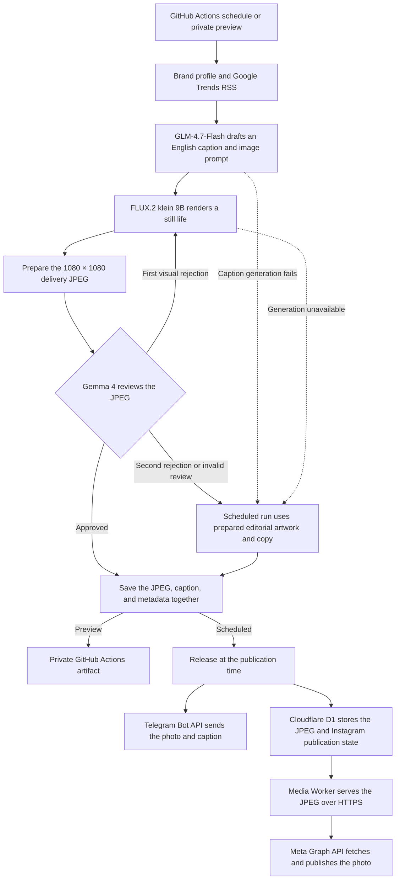

# Content Automation architecture

Content Automation is a reusable Node.js library and CLI. A deployment supplies a brand profile, credentials, a schedule, and the delivery destinations. The diagram shows the shared-photo deployment used for Onypheus, with the object-only image policy enabled.

A strict preview requires a newly generated, approved image and fails if that image is unavailable. The editorial fallback is used by the scheduled deployment.

## Models

| Stage | Workers AI model | Responsibility |
| --- | --- | --- |
| Draft | [GLM-4.7-Flash](https://developers.cloudflare.com/workers-ai/models/glm-4.7-flash/) | Select a relevant trend from today or yesterday in the brand's timezone, or use one of the profile's editorial topics. Draft the caption and image prompt. |
| Image | [FLUX.2 `[klein]` 9B](https://developers.cloudflare.com/workers-ai/models/flux-2-klein-9b/) | Generate the square artwork for a profile with `imageReview` enabled. The default image generator for other profiles is [FLUX.1 Schnell](https://developers.cloudflare.com/workers-ai/models/flux-1-schnell/). |
| Visual review | [Gemma 4 26B A4B](https://developers.cloudflare.com/workers-ai/models/gemma-4-26b-a4b-it/) | Inspect the exact JPEG that would be delivered. Reject people and body parts, obvious malformed objects, visible lettering, watermarks, and unreadable compositions. Supply alt text from the image if approved. |

The Onypheus profile asks for a concise English caption with a concrete action. If the caption falls below the profile's minimum length, the engine requests one rewrite before generating an image. The image prompt and renderer both use an inanimate still life with a clear focal point. One visual rejection triggers a simpler redraw. A failed request, malformed decision, or second rejection stops AI publication. Review is an automated visual check and can miss defects.

## Scheduling and delivery

- **GitHub Actions** prepares the Onypheus post at 06:55 WITA and targets 07:00 WITA (23:00 UTC on the preceding UTC date) for delivery. The 07:09 WITA recovery run can reuse the same private artifact if delivery needs a safe retry. GitHub can delay scheduled jobs.
- **Telegram** receives the JPEG and caption directly from the runner. A publication reservation in the private repository prevents repeated sends after an uncertain delivery.
- **Instagram** receives the same JPEG and caption. The runner saves the image in D1, and the media Worker serves it at a temporary HTTPS URL so Meta can fetch it. The runner creates and publishes the Instagram media container. D1 tracks the container and publication state for retries.
- **Billing** uses the shared [Workers AI daily free allocation](https://developers.cloudflare.com/workers-ai/platform/pricing/) on Workers Free. A scheduled run generates at most two candidate images and reuses the approved image across channels.

See [Cloudflare setup](cloudflare-setup.md) for the inference token and media Worker, and [Instagram setup](instagram-setup.md) for Meta authorization.
